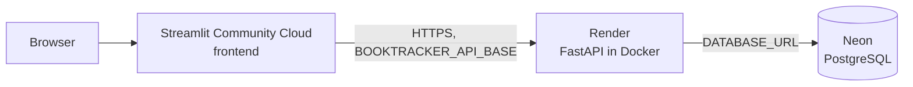
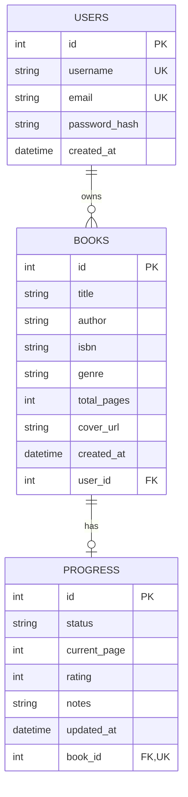

# Book Tracker App (SQRS S26)


[](https://github.com/3llimi/BookTrackerApp-SQRS-S26/actions/workflows/ci.yml)

Book Tracker is a FastAPI + Streamlit application for personal reading management.
It supports authentication, book CRUD, reading progress tracking, filtering/search, and Open Library integration.

This repository is built for Software Quality, Reliability, and Security (SQRS) and includes:

- layered automated tests (unit, integration, E2E)
- schema and business validation checks
- static quality gates (lint, security, complexity)
- Locust performance testing and reporting

## Table of Contents

1. [Live Demo](#1-live-demo)
2. [Features and Tech Stack](#2-features-and-tech-stack)
3. [Quick Start](#3-quick-start)
4. [Deployment](#4-deployment)
5. [API Documentation](#5-api-documentation)
6. [Database Model](#6-database-model)
7. [Testing](#7-testing)
8. [Quality Tooling and Metrics](#8-quality-tooling-and-metrics)
9. [Development Commands](#9-development-commands)

## 1. Live Demo

- App (Streamlit): https://bookstracker.streamlit.app/
- API docs (Swagger UI): https://booktracker-api-3f3a.onrender.com/docs

Demo account (or register your own):

- Email: `test@test.com`
- Password: `test123`

The app is deployed on free tiers (see [4. Deployment](#4-deployment)), so the first request after a period of inactivity can take about 30 seconds while the API wakes up.

## 2. Features and Tech Stack

### Features

- JWT authentication (register and login)
- book CRUD with per-user ownership
- reading progress tracking (status, current page, rating, notes)
- search, filter, and sort across a user's library
- Open Library lookup for book metadata

### Tech stack

| Layer | Technology |
| --- | --- |
| API | FastAPI, Pydantic, SQLAlchemy |
| Frontend | Streamlit |
| Database | SQLite (local), PostgreSQL on Neon (production) |
| Packaging | Poetry, Docker |
| Quality | pytest, Hypothesis, flake8, bandit, radon, Locust |
| CI | GitHub Actions |

### Project structure

```text
src/              FastAPI app: routers, services, models, schemas, database
frontend/         Streamlit helpers and page logic
pages/            Streamlit multipage entries
streamlit_app.py  Streamlit entrypoint
tests/            unit and integration tests
scripts/          complexity check and frontend theme scripts
docs/             Locust report
Dockerfile        API container image
docker-compose.yml  local API + frontend
render.yaml       Render deployment blueprint
neon.ts           Neon project configuration
```

## 3. Quick Start

### Prerequisites

- Python 3.11+
- Poetry

### Install dependencies

```bash
poetry install
```

### Environment variables

Create a `.env` file in the project root (it is gitignored):

```text
JWT_SECRET=replace-with-a-long-random-secret
```

Optional:

- `DATABASE_URL`: Postgres connection string. When it is not set, the app uses the local SQLite file `books.db`, so no database server is needed for local development.
- `BOOKTRACKER_API_BASE`: API URL used by the Streamlit frontend. Defaults to `http://localhost:8000/api/v1`.

### Run the API (FastAPI)

```bash
poetry run uvicorn src.main:app --reload --host 127.0.0.1 --port 8000
```

API docs:

- Swagger UI: http://127.0.0.1:8000/docs
- OpenAPI JSON: http://127.0.0.1:8000/openapi.json

### Run Streamlit

Use the root entrypoint:

```bash
poetry run streamlit run streamlit_app.py
```

Or run the frontend entry module directly:

```bash
poetry run streamlit run frontend/app.py
```

Optional theme scripts:

```powershell
./scripts/run_frontend_light.ps1
./scripts/run_frontend_dark.ps1
```

### Run with Docker

```bash
touch books.db
docker compose up --build
```

- API: http://localhost:8000/docs
- Frontend: http://localhost:8501

Create `books.db` before the first run. If the file does not exist, Docker creates a directory with that name and SQLite cannot open it.

## 4. Deployment

The deployed app is made of three free services, all driven from the `main` branch of this repository:



| Layer | Service | Source | Configuration |
| --- | --- | --- | --- |
| Frontend | Streamlit Community Cloud | `streamlit_app.py` | Secret `BOOKTRACKER_API_BASE` |
| API | Render (Docker) | [Dockerfile](Dockerfile) and [render.yaml](render.yaml) | `DATABASE_URL`, `JWT_SECRET`, `PORT` |
| Database | Neon (PostgreSQL) | [neon.ts](neon.ts) | Connection string used as `DATABASE_URL` |

### Database selection

[src/database.py](src/database.py) chooses the database from the `DATABASE_URL` environment variable:

- not set: SQLite file `books.db` (local development)
- `postgres://...` or `postgresql://...`: converted to `postgresql+psycopg://...` and used with connection health checks (`pool_pre_ping`)

Tests always run on an in-memory SQLite database. [tests/conftest.py](tests/conftest.py) forces this, so a local `.env` can never point the test suite at a real database.

### Deploy the API (Render)

1. Push the code to `main`.
2. In Render, choose New, then Blueprint, and select this repository. Render reads [render.yaml](render.yaml).
3. Set `DATABASE_URL` to the pooled Neon connection string. `JWT_SECRET` is generated automatically.
4. Open `/docs` on the service URL to confirm the API is running.

Keep secrets such as `DATABASE_URL` and `JWT_SECRET` in the Render dashboard only. Never commit them.

### Deploy the frontend (Streamlit Community Cloud)

1. Create a new app from this repository: branch `main`, main file `streamlit_app.py`, Python 3.11.
2. Under Advanced settings, add this secret:

```toml
BOOKTRACKER_API_BASE = "https://booktracker-api-3f3a.onrender.com/api/v1"
```

### Free tier notes

- Render puts the API to sleep after about 15 minutes without traffic, so the next request takes roughly 30 seconds.
- User data is stored in Neon, so it survives API restarts and redeploys. The local SQLite file on Render's disk does not, which is why `DATABASE_URL` must be set in production.
- CI runs on every push and pull request to `main`. See [.github/workflows/ci.yml](.github/workflows/ci.yml).

## 5. API Documentation

All API endpoints include both summary and description metadata visible in `/docs`.
Router handlers have explicit summaries, descriptions, and docstrings across:

- auth routes
- books routes
- progress routes
- openlibrary routes

OpenAPI verification result:

```text
missing_count= 0
total_ops= 12
```

## 6. Database Model

The persistence layer is defined with SQLAlchemy ORM models in [src/models.py](src/models.py).



| Table | Key fields | Constraints | Relationships |
| --- | --- | --- | --- |
| `users` | `id`, `username`, `email`, `password_hash`, `created_at` | `username` and `email` are unique and required | One user owns many books |
| `books` | `id`, `title`, `author`, `isbn`, `genre`, `total_pages`, `cover_url`, `created_at`, `user_id` | `total_pages` is null or non-negative | Each book belongs to one user and has at most one progress row |
| `progress` | `id`, `status`, `current_page`, `rating`, `notes`, `updated_at`, `book_id` | `rating` is 1-5, `current_page` is non-negative, `status` is one of `not_started`, `reading`, `completed` | One progress row belongs to exactly one book |

The `books` and `progress` tables are configured with cascading deletes so related rows are removed when a parent record is deleted.

## 7. Testing

### 7.1 Commands

Full test suite:

```bash
poetry run pytest -q
```

Expected output (current run):

```text
170 passed
```

Coverage gate:

```bash
poetry run pytest --cov=src --cov-fail-under=70 --cov-report=xml
```

Expected output (current run):

```text
Required test coverage of 70% reached. Total coverage: 94.30%
170 passed
```

### 7.2 Overview

The Book Tracker App uses a multi-layered testing strategy designed to verify correctness, reliability, isolation, validation rules, API behavior, and quality gate compliance.

The suite is built around these principles:

- business logic tested at service level with unit tests
- HTTP behavior tested through FastAPI TestClient
- full user flows tested end-to-end
- external API integration tested with mocks
- search logic stress-tested with property-based testing
- performance validated separately with Locust
- all tests run against an isolated test database

### 7.3 Goals

- Functional correctness for auth, books, progress, search, and Open Library integration
- Security correctness for authenticated access and user isolation
- Validation correctness at schema, service, and API layers
- Data integrity (uniqueness, cascade delete, one-to-one progress relationship)
- Behavior consistency (derived status, nested response structures)
- CI quality readiness with stable reproducible test runs

### 7.4 Stack

- Pytest
- FastAPI TestClient
- SQLite in-memory test database
- Hypothesis
- pytest-cov
- Locust
- monkeypatch/mocking for Open Library

### 7.5 Suite Structure

#### Unit tests

Location: `tests/unit/`

Files:

- tests/unit/test_auth.py
- tests/unit/test_books.py
- tests/unit/test_openlibrary.py
- tests/unit/test_progress.py
- tests/unit/test_search.py

Focus:

- service-layer logic
- schema validation behavior
- business rules and helper logic
- Open Library mapping/parsing behavior without route execution

#### Integration tests

Location: `tests/integration/`

Files:

- tests/integration/test_api.py
- tests/integration/test_auth_api.py
- tests/integration/test_books_api.py
- tests/integration/test_e2e.py
- tests/integration/test_openlibrary_api.py
- tests/integration/test_progress_api.py
- tests/integration/test_search_api.py

Focus:

- real API route behavior
- auth headers and route protection
- response status codes and payload contracts
- request validation and ownership isolation

#### Shared infrastructure

Location: `tests/conftest.py`

Provides:

- isolated test DB engine and lifecycle
- function-scoped DB sessions
- dependency override for `get_db`
- function-scoped TestClient
- stable JWT secret in test environment
- a forced in-memory `DATABASE_URL`, so tests never reach a real database

### 7.6 Environment Isolation

- tests never use the production or development `books.db`, or any database from a local `.env`
- per-test transactions are rolled back
- test data does not leak across tests
- API tests use overridden DB dependency for deterministic behavior

### 7.7 Coverage by Component

- Auth: registration/login uniqueness and JWT claim checks
- Books: CRUD, duplicate ISBN per-user, ownership, cascade delete
- Progress: creation/update rules, status derivation, rating/page validation
- Search: filtering, sorting, robustness against malformed input, user isolation
- Open Library: success/empty/error mappings with network failures mocked
- Schemas: direct Pydantic validation and ORM serialization checks

### 7.8 Property-Based Testing

Property-based cases in `tests/unit/test_search.py` validate invariants such as:

- no crashes for arbitrary query text
- return type stability
- safe behavior for malformed/adversarial inputs

### 7.9 Performance Testing

Performance testing is defined in `locustfile.py`. Start the API in one terminal, then run the load test in another:

```bash
poetry run locust -f locustfile.py --host http://127.0.0.1:8000 --headless -u 50 -r 10 -t 1m --html docs/locust_report.html
```

Expected output:

```text
Headless run summary with request statistics and failures.
HTML report generated at docs/locust_report.html.
```

A previous successful local run produced:

- zero failures
- authenticated traffic against API flows
- report artifact: docs/locust_report.html

### 7.10 External API Testing Strategy

Open Library tests mock httpx calls to cover:

- successful responses
- timeouts and connection failures
- malformed JSON
- upstream HTTP error conversion

Benefits:

- deterministic CI behavior
- no internet dependency
- full edge-case coverage control

### 7.11 Security and Validation Strategy

- protected route checks (401 without auth)
- invalid token rejection
- strict user isolation across reads/updates/deletes
- layered validation: schema-level (ValidationError), service-level (HTTPException), API-level (422)

### 7.12 CI Quality Gates

The pipeline in [.github/workflows/ci.yml](.github/workflows/ci.yml) runs on every push and pull request to `main` and uses:

- flake8 (`flake8 src/`)
- bandit (`bandit -r src/ -ll`)
- radon (`scripts/check_complexity.py`)
- pytest with coverage gate

Core CI coverage command:

```bash
pytest --cov=src --cov-fail-under=70 --cov-report=xml
```

### 7.13 Current Strengths

- clear separation of unit/integration/E2E
- robust isolated test DB strategy
- realistic API-level assertions
- ownership/security behavior thoroughly tested
- property-based testing for search robustness
- performance checks available via Locust

### 7.14 Known Limitations

- tests run on SQLite while the deployed app runs on PostgreSQL, so SQLite-specific behavior may differ from production
- migration testing is not present (`create_all`-based setup)
- live upstream Open Library behavior is not tested in CI (mocked by design)

### 7.15 Requirement Traceability (Summary)

- Unit business logic and validation: tests/unit/* + tests/test_schemas.py
- E2E workflow coverage: tests/integration/test_e2e.py
- Auth register/login flow: tests/integration/test_auth_api.py + E2E
- Book lifecycle and progress behavior: books/progress integration + E2E
- Filtering/search behavior: search unit/integration + E2E
- User data isolation: books/progress/search integration + E2E
- External API integration behavior: openlibrary unit/integration tests

## 8. Quality Tooling and Metrics

### flake8

```bash
poetry run flake8 src tests frontend
```

Expected output (current run):

```text
No output (exit code 0).
```

### bandit

```bash
poetry run bandit -r src
```

Expected output (current run):

```text
Exit code 1.
1 Low-severity finding (B105 hardcoded_password_string) in src/routers/auth.py.
```

CI runs `bandit -r src/ -ll`, which only fails on Medium and High findings, so this Low finding does not fail the build.

### radon

```bash
poetry run radon cc src -a
```

Expected output (current run):

```text
Average complexity: A (2.5893)
```

### Verified metrics

The values below are from actual runs/artifacts in this repository:

| Metric | Result |
| --- | --- |
| Tests | 170 passed |
| Coverage | 94.30% |
| flake8 | 0 violations |
| Radon average grade | A (2.5893) |
| Bandit findings | 1 Low (B105), 0 Medium, 0 High |
| Locust P95 (aggregated) | 130 ms (from docs/locust_report.html) |

## 9. Development Commands

```bash
poetry run pytest
poetry run pytest -q
poetry run flake8 src tests frontend
poetry run bandit -r src
poetry run radon cc src -a
poetry run streamlit run streamlit_app.py
poetry run uvicorn src.main:app --reload
```

If a pip-compatible export is required:

```bash
poetry export -f requirements.txt --output requirements.txt --without-hashes
```
